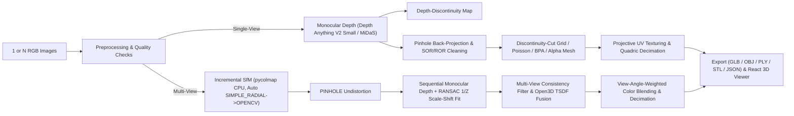

# HoloGen — AI-Powered 3D Scene Reconstruction & Generation Platform

> **"From pixels to spatial intelligence."**

HoloGen turns single or multiple 2D images into interactive, exportable 3D scenes (`GLB`, `OBJ`, `PLY`, `STL`, `JSON`) with measured geometric and photometric reconstruction reports. Engineered from scratch in Python (`PyTorch`, `Open3D`, `pycolmap`, `Trimesh`, `FastAPI`) and TypeScript (`React`, `Three.js` / `React Three Fiber`), designed to run end-to-end on a **7.7 GB RAM / 2 GB VRAM** Windows workstation.

---

## Architecture



---

## Implemented vs. Not Implemented

| Implemented | Not Implemented (Future Scope) |
| :--- | :--- |
| Single-view pipeline (preprocessing, EXIF/FOV intrinsics, modular depth models, SOR/ROR cleaning, 4 meshers, projective UV texturing, `120k`-face viewer + full-res exports) | Video-stream reconstruction |
| From-scratch pure-NumPy two-view epipolar geometry (Hartley normalization, 8-pt F, Sampson MSAC, 5-DoF Sampson Gauss–Newton, Essential decomposition, cheirality, DLT) | Gaussian Splatting / NeRF optimization |
| N-view incremental SfM via `pycolmap` (`CameraMode.SINGLE`, `SIMPLE_RADIAL -> OPENCV` fallback, `PINHOLE` undistortion, `Sim(3)` Umeyama) | Full PatchMatch dense MVS |
| Sequential sparse-aligned monocular depth + discontinuity & multi-view consistency filtering + Open3D `ScalableTSDFVolume` fusion + view-angle color blending | Semantic scene understanding / AI scene assistant |
| FastAPI concurrency-1 queue (`/api/upload`, `/api/upload-multi`, `/api/reconstruct`, `/api/cancel`, `/api/export`) + React Three.js studio with 3D camera frustums | Cloud / Kubernetes deployment |

---

## Windows Installation & Quick Start

> Tested on Windows 11 (64-bit), Python `3.10.11`, Intel i5-1135G7, 7.7 GB RAM, NVIDIA GeForce MX330 (2 GB VRAM, `sm_61`).

```powershell
# 1. Clone and create virtual environment
git clone <repo-url> HoloGen
cd HoloGen
python -m venv .venv

# 2. Install CUDA 12.1 PyTorch (Pascal sm_61 compatible) and pinned dependencies
.\.venv\Scripts\python.exe -m pip install torch==2.4.1+cu121 torchvision==0.19.1+cu121 --index-url https://download.pytorch.org/whl/cu121
.\.venv\Scripts\python.exe -m pip install -r requirements.txt
# Exact frozen environment is also pinned in requirements.lock.txt

# 3. Verify unit & E2E tests (49 tests)
.\.venv\Scripts\python.exe -m pytest -q -p no:logging

# 4. Build frontend (use npm.cmd on Windows; package.json pins @rollup/wasm-node & esbuild-wasm for Smart App Control)
cd frontend
npm.cmd install
npm.cmd run build
cd ..

# 5. Start Web Studio (FastAPI serves API + built frontend on http://127.0.0.1:8000)
.\.venv\Scripts\python.exe -m uvicorn app.main:app --app-dir backend --host 127.0.0.1 --port 8000
```

### Reproducing Experiments & Benchmarks
```powershell
# Quick verification & result consolidation into docs/results/
.\.venv\Scripts\python.exe scripts\reproduce_all.py --quick

# Full end-to-end re-execution of all benchmark scripts (fixed seeds)
.\.venv\Scripts\python.exe scripts\reproduce_all.py --full
```

*(Note: `backend/Dockerfile` and `docker-compose.yml` are provided for containerized deployment, but `docker build` has not been verified on this Windows host.)*

---

## Key Measured Results

### 1. Experiment A — Monocular Depth ($n = 8$ Indoor RGB-D Scenes, Least-Squares Scale-Shift Aligned)
| Model | Refinement | Abs Rel $\downarrow$ | RMSE (m) $\downarrow$ | $\delta < 1.25$ $\uparrow$ | Edge F1 $\uparrow$ | Latency (ms) |
| :--- | :--- | :---: | :---: | :---: | :---: | :---: |
| **`depth_anything_v2_small`** | `none` *(default)* | **0.0945** | **0.3511** | **0.9038** | **0.6727** | 45.2 |
| `depth_anything_v2_small` | `guided` | 0.0955 | 0.3511 | 0.9022 | 0.6544 | 45.6 |
| `depth_anything_v2_small` | `bilateral` | 0.0957 | 0.3522 | 0.9011 | 0.5873 | 46.8 |
| `dpt_hybrid_midas` | `none` | 0.1306 | 0.4408 | 0.8404 | 0.5784 | 132.4 |

### 2. Phase 7b.5 — Two-View Epipolar Geometry (10 Pairs × 3 Seeds = 30 Runs/Method/Scene)
| Scene | Method | Rot. Error (°) Med [IQR] | Trans. Dir. Error (°) Med [IQR] | Reproj. RMSE (px) Med [IQR] |
| :--- | :--- | :---: | :---: | :---: |
| **ETH3D `pipes`** *(Undist. `PINHOLE`, GT)* | Ours (`from_scratch_8pt_no_gn`) | 0.210 [1.278] | 4.900 [9.675] | 2.314 [11.890] |
| **ETH3D `pipes`** *(Undist. `PINHOLE`, GT)* | **Ours (`from_scratch_8pt_with_gn`)** | **0.247 [0.655]** | **0.904 [1.645]** | **0.321 [0.171]** |
| **ETH3D `pipes`** *(Undist. `PINHOLE`, GT)* | OpenCV 5-Pt / `pycolmap` | 0.400 / 0.267 | 1.155 / 0.883 | 0.401 / 0.343 |
| **Fountain** *(RGB-D Ref. `key.log`)* | **Ours (`from_scratch_8pt_with_gn`)** | **1.012 [0.617]** | **3.590 [2.077]** | **0.247 [0.078]** |

### 3. Experiment D v2 — Single-View vs. Multi-View Fusion (`ETH3D pipes` Faro Laser GT, Equal-Density, NO ICP Headline)
| Method | GT-AABB F1 (`0.10 m`) | `N=1` Frustum F1 (`0.10 m`) | Trunc. Chamfer (`0.10 m`) | Per-View Depth Abs Rel Med [IQR] |
| :--- | :---: | :---: | :---: | :---: |
| Single-View (`N=1`, oracle scale) | 0.099 | 0.226 | 0.0950 m | 0.1688 [0.1450] |
| Single-View (`N=1`, oracle scale+shift) | 0.257 | **0.802** | **0.0741 m** | **0.0736 [0.0366]** |
| **Multi-View TSDF (`N=14`, `relaxed`)** | **0.276** *(ICP: 0.473)* | 0.657 *(default: 0.699)* | 0.0896 m | **0.0963 [0.0370]** *(0 GT depth)* |

*(See [docs/evaluation.md](file:///d:/HoloGen/docs/evaluation.md) and [docs/experiments.md](file:///d:/HoloGen/docs/experiments.md) for Fountain tables, system metrics, and full methodology.)*

---

## Key Limitations
- Single-view depth has inherent scale ambiguity and only observes a 2.5D front shell (watertight meshers hallucinate occluded backsides).
- The spatial log-depth **depth-discontinuity map** is NOT calibrated uncertainty ($\bar{\rho}_{\text{abs}} = +0.1083$ across $n=8$ scenes).
- `SampleFountainRGBDImages` (`key.log` / `integrated.ply`) is an RGB-D reference reconstruction, not ground truth.
- Multi-view fusion aligns monocular depth to sparse SfM points rather than running dense PatchMatch MVS, and centre-only `Sim(3)` alignment on clustered cameras (`ETH3D`) leaves residual frame drift (`ICP` raises `N=14` F1 from `0.276` to `0.473`).

---

## Models, Datasets & License

- **Project License:** [MIT License](file:///d:/HoloGen/LICENSE) — compatible with all core dependencies (`torch` BSD, `open3d` MIT, `trimesh` MIT, `opencv-python` Apache-2.0, `pycolmap` BSD-3-Clause, `transformers` Apache-2.0, `fastapi` MIT).
- **Pretrained Models:** `Depth Anything V2 Small` (Apache-2.0), `DPT-Hybrid MiDaS` (MIT) — weights are cached locally and never committed (see [models/README.md](file:///d:/HoloGen/models/README.md)).
- **Datasets:** `Open3D SampleFountainRGBDImages` (MIT), `ETH3D pipes` (CC-BY-SA), `NYU V2` / `SUN RGB-D` (MIT via Open3D), `TUM RGB-D` (CC-BY-4.0), `Redwood RGB-D` (CC0).
