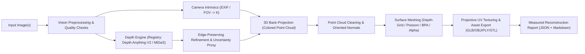

# HoloGen System Architecture

## 1. Design Philosophy: Library First, Web Second

HoloGen is architected as a modular Python computer vision and 3D geometry package (`backend/app`) with deterministic CLI runners (`scripts/`) and unit-tested mathematical primitives (`backend/tests/`). All web API (`FastAPI`) and interactive 3D visualization (`React Three Fiber`) layers consume the exact same pipeline interfaces without duplicating geometry or inference logic.

## 2. Module Responsibilities

| Module | Path | Responsibility |
| :--- | :--- | :--- |
| **Core** | `backend/app/core/` | `HoloGenSettings` (Pydantic Settings), CUDA kernel verification with automatic CPU fallback, structured logging, typed exceptions. |
| **Vision** | `backend/app/vision/` | EXIF orientation & metadata extraction, Laplacian variance blur detection, Rec.709 exposure analysis, pinhole camera intrinsics $K$, modular `DepthModel` registry, guided/bilateral depth refinement, and monocular uncertainty proxy computation. |
| **Geometry** | `backend/app/geometry/` | Vectorized depth back-projection, statistical & radius outlier removal, voxel downsampling, normal estimation & camera-orientation consistency, discontinuity-aware depth-grid triangulation, Open3D mesh comparison methods, mesh cleanup, projective UV texturing, and multi-format export (`GLB`, `OBJ`, `PLY`, `STL`). |
| **Pipelines** | `backend/app/pipelines/` | End-to-end `SingleViewPipeline` and `MultiViewPipeline` orchestrators with per-stage timing and memory telemetry. |
| **Evaluation** | `backend/app/evaluation/` | Scale-shift aligned depth metrics (`Abs Rel`, `Sq Rel`, `RMSE`, `RMSE log`, $\delta < 1.25$), gradient edge-preservation metric, and 3D surface metrics (`Chamfer`, `Hausdorff`, `Precision`, `Recall`). |

## 3. Hardware-Aware Resource Management

Designed and tested on a constrained local workstation (**NVIDIA GeForce MX330 with 2048 MiB VRAM**, Pascal `sm_61`, and **7.70 GB System RAM**):
- **Resolution Guard:** Configurable `max_image_dimension` (default `640`) bounds dense point clouds to $\le 307,200$ points per view.
- **CUDA Runtime Probe & OOM Fallback:** `detect_compute_device()` executes a test tensor kernel on startup and wraps inference in an automatic `torch.cuda.empty_cache()` + CPU fallback guard.
- **Localized Model Cache:** Sets `HF_HOME` and `TORCH_HOME` inside `D:\HoloGen\models\cache` so model weights never pollute the OS system drive.
